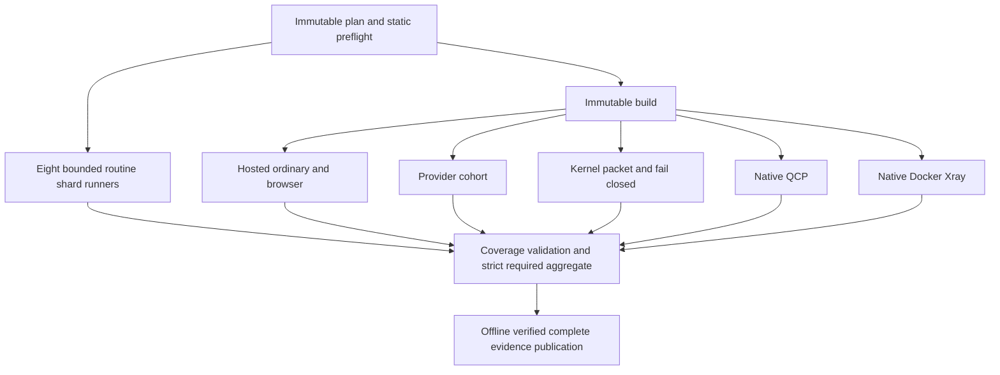

# CI V3: visible qualification and parallel execution

## Stage 6.2.5 — measured baseline and qualification preparation (2026-11-05)

Current implementation branch: `stage6/ci-test-architecture`, starting at `158f5f5725c974622c374ffa20edb1205940c7b2`. Stages 6.2.1–6.2.4 are accepted within their recorded source/verification scope. Stage 6.2 is not fully qualified: no new branch/PR/main/L6 hosted run is established by local tests. This section supersedes older planning/status statements below only for current Stage 6.2 work; historical source identities and results remain unchanged.

### Actual hosted observations; not measurements of the Stage 6.2 HEAD

All three observations are attempt 1 at **`cfb0a4540b672b22b43da8da81acdf91385742f6`**, on `ubuntu-24.04`. Read-only GitHub Actions run/jobs/artifacts API data was inspected on 2026-11-05. L6 schedule and manual runs have the same source but different trigger/cache/runner conditions; Main has a distinct single-repeat policy. They are not a matched optimization experiment.

| Run | Event/profile | Wall seconds | Sum job minutes | Runner jobs | Artifacts / API bytes |
|---|---|---:|---:|---:|---:|
| [41833555265](https://github.com/Coxf0rd/fwrouter/actions/runs/41833555265) | push / actual Main | 490 | 35.500 | 16 | 16 / 5,628,242 |
| [41833603309](https://github.com/Coxf0rd/fwrouter/actions/runs/41833603309) | dispatch / L6 main | 484 | 51.067 | 19 | 19 / 5,358,257 |
| [42025975917](https://github.com/Coxf0rd/fwrouter/actions/runs/42025975917) | schedule / L6 main | 464 | 53.567 | 19 | 19 / 5,358,003 |

Wall is `max(jobs.completed_at) - run.run_started_at`; job cost is the sum of `completed_at - started_at`, divided by 60. These are whole-second API observations, not billed minutes, CPU time, queue-free service time or complete workflow-finalization time. Artifact bytes sum API `size_in_bytes` for the run, not network traffic or uncompressed size.

Raw per-job durations (seconds), retained here as the minimum reproducible measurement record:

| Job/group | Main 41833555265 | L6 41833603309 | L6 42025975917 |
|---|---:|---:|---:|
| Plan/preflight | 22 | 22 | 31 |
| Build | 28 | 27 | 34 |
| Routine: core-state | 114 | 79 | 106 |
| Routine: services-events | 113 | 129 | 120 |
| Routine: ui-tooling | 63 | 54 | 70 |
| Routine: routing-adapters | 121 | 151 | 175 |
| Routine: api-persistence-contracts | 38 | 44 | 37 |
| Routine: ui-provider-contracts | 44 | 38 | 59 |
| Routine: local-integration | 243 | 264 | 283 |
| Routine: installer-startup | 107 | 100 | 93 |
| Hosted: single/r1 | 408 | 354 | 367 |
| Hosted: r2 | n/a | 407 | 343 |
| Provider/browser: single/r1 | 312 | 306 | 355 |
| Provider/browser: r2 | n/a | 303 | 314 |
| Packet: single/r1 | 355 | 293 | 283 |
| Packet: r2 | n/a | 347 | 367 |
| Native QCP | 100 | 92 | 103 |
| Native Docker-Xray | 40 | 35 | 53 |
| Final strict qualification | 22 | 19 | 21 |

In the latest L6 run, hosted-r1 and packet-r2 finish at offset 440 s; aggregate starts at 443 s and ends at 464 s. Local-integration finishes at 429 s, after waiting until offset 146 s to start. In the other L6 run, hosted-r2 finishes at offset 463 s; aggregate runs at 465–484 s and local-integration ends at 392 s. Main hosted finishes at offset 466 s, aggregate runs at 468–490 s, local-integration ends at 384 s. Thus routine imbalance is real, but neither run proves routine repartitioning would shorten the overall critical path. Waiting includes max-parallel/capacity/scheduling effects and is not attributed solely to test code.

API execution steps include provision/test/cleanup within the worker: latest L6 hosted-r1/r2 348/321 s, provider-r1/r2 327/289 s, packet-r1/r2 263/341 s, QCP 74 s, Docker-Xray 19 s. Routine execution steps range 9–242 s; job setup/teardown differences are not pure reusable overhead. Latest plan Python/Node setup steps are 11/10 s; build Python/Node setup 13/8 s versus 3 s build work. Final Main download/aggregate/build-verify/publish steps are 1/2/1/2 s. API second granularity can show zero for real short work; this does not prove zero cost. No isolated browser, cleanup or wire-transfer cost is inferred from combined steps.

The downloaded latest L6 success bundle has 77 content-manifest entries; exact file closure, sizes and SHA-256 hashes match. Its metadata matches external source/run/attempt and records 3,501 unique cases / 3,547 executions, all PASS, no SKIP. This is historical evidence only; no strict replay against the new Stage 6.2 source was claimed. Its local-integration shard retains 240.094 s summed suite execution, with largest suites `test_mihomo_config_runtime.py` 47.141 s and `test_ui_client_list_settings.py` 35.583 s. Observed runner snapshot: 4 CPUs, 16,760,344,576 bytes MemTotal; shard process max RSS 640,352 KiB. RSS is a process observation, not container/runner peak memory.

### Decision and reproducible method

Retain the existing DAG, eight deterministic routine shards/max four, independent L6 repeats, cache policy, immutable build reuse and 1/3/7-day retention. Do not split browser/runtime groups, reorder/rebalance shards or add caches without matched new-source evidence including startup/cleanup and runner-minute cost. There is **no demonstrated Stage 6.2 speedup**.

For a future authorized run, inspect `gh api repos/Coxf0rd/fwrouter/actions/runs/<RUN>` plus `/jobs?per_page=100` (paginate if necessary) and `/artifacts?per_page=100`; retain the run/attempt/source/profile, runner image and raw job/step timestamps. Compute wall/job-time consistently above, distinguish omitted/failed/cancelled jobs, and compare same-source/profile repetitions. Use sealed producer measurements for provision/commands/resources and existing shard/launcher receipts for suite/phase details. Routine summed suite execution is nested inside the unit command wall duration: these observations overlap and must not be added together as worker, workflow or runner cost. Process CPU/RSS belongs to the observed command; a suite-total scalar does not establish an independent suite peak. Missing or unsupported fields remain NOT MEASURED; timings cannot qualify tests. GitHub metadata is external provenance, while content hashes alone do not authenticate origin. The exact-source PR/Main/L6 success bundles still require independent strict offline replay.

---

## Baseline and scope

The starting source is `ccb8de81be68585d95a327e6d1835ea7387de24a` (PR39). Actual-main run [39912198441](https://github.com/Coxf0rd/fwrouter/actions/runs/39912198441), attempt 1, completed all eight jobs successfully. Its downloaded main bundle passed the trusted-source offline verifier, including main smoke and safe recovery. The owner confirmed completion of the separate production rollout before implementation began. This CI change performs no deployment and does not qualify private deployment-wrapper bytes.

The baseline manifest registers 184 files: 110 L1, 34 L2, 34 L3, five L4 and one L7. There are 183 safe L1–L4 files. Ten L5 anchors retain their primary levels and must not be rerun merely to create a regression job. File profiles are 169 routine, seven qualified-child-process, six hosted-isolated-compose (including L7), and two kernel-packet. These are file counts, not individual cases.

The actual baseline routine report has 2,163 passing status entries. Hosted ordinary/provider/packet receipts add 27/12/4 cases; QCP and Docker-Xray add 43/1. Thus the baseline has 2,250 distinct reported IDs, **not a uniformly granular count of individual test methods**: stdlib suites previously used file-level status markers, and Node file wrappers coexist with TAP cases. Comparisons must retain this distinction when V3 exposes finer inventories. Never infer executed counts from manifest rows or green jobs.

## Trust and ownership

The existing gate manifest remains the source of test selection, primary levels, domains, dependency closure, L5 anchors and execution profiles. Deterministic partitions assign execution ownership; they do not reclassify levels or weaken baseline policy. The existing hosted/native strict validator remains authoritative after verified shard reports are reconstructed into its canonical routine-report contract.

Every selected suite must have exactly one executor. Producer evidence is untrusted until source, manifest, immutable plan, run and attempt identities, expected partition, file inventory and actual node results have been checked. Missing, duplicate, wrong-partition, uncollected, skipped, failed, stale-attempt or incomplete evidence cannot establish eligibility. Regression coverage validates evidence; it does not execute anchors twice.

The stable required check remains `Affected L0-L5 with hosted profiles`. Final evidence build, offline replay and publication stay within that job. Publication failure fails the required result. PR evidence cannot replace actual-main qualification. Missing or expired main evidence remains NO DEPLOY under the public manual-deployment contract.

## Execution graph

The diagram groups real runner instances rather than implying a new ownership service. QCP and Xray use separate native matrix children; eight routine matrix children are bounded to four concurrent runners. This gives 16 runner jobs when both native profiles and all hosted profiles are selected (eight logical YAML job identifiers, with matrix expansion), rather than adding jobs only to reach a nominal count of 18. Static checks stay with the planner and coverage validation with the required aggregate to avoid two runner startups/artifact handoffs that add no test isolation. Evidence publication remains steps of the required job, so publication failure cannot leave an eligible green required check.

## Trigger policy

| Mode | Qualification |
| --- | --- |
| Feature push | Existing fast affected L0–L1; explicit deferrals; non-promotional |
| Ordinary PR | Affected L0–L5 plus selected hosted/native/packet profiles |
| Final PR | `ci:full-acceptance` selects all mandatory safe L0–L5 at exact PR HEAD |
| Actual main | Full mandatory safe L0–L5 and independent main smoke |
| Nightly/manual L6 | Separate exact-source full safe regression; unchanged in PR A |
| Release | Fresh exact-release L6 plus independent mandatory main CI; separately authorized extra gates |
| L7 | Explicit authorized disposable staging only; never inferred from hosted success |

## Artifact lifecycle

Preserve PR39: runner-local intermediate state; one-day sealed cross-job handoffs; three-day redacted failed diagnostics; seven-day complete final evidence. No writable PR token, privileged cleanup workflow, production credentials or persistent runner is introduced. More visible jobs may increase short-lived handoff count; the long-lived result remains one complete evidence bundle. A checksum inventory detects content changes but is not a GitHub-origin signature; consumers must independently verify workflow/run metadata.

## PR B: separate stacked full L6 workstream

The owner subsequently authorized implementation and qualification on a separate stacked branch above qualified PR A, without waiting for merge. Keep the existing nightly/manual workflow operational in PR A. PR B must explicitly declare its PR A dependency; stacked-head qualification is not actual-main qualification. Only the owner merges, first A and then the integrated B after renewed qualification as required.

The full plan must select every safe registered file and exclude L7. Reuse the qualified partition/node-accounting contract from PR A with an explicit L6 mode. Proposed graph: full immutable plan → static/build and independent routine domain shards → independent hosted repeat 1 and repeat 2, QCP, Docker-Xray and packet/runtime-scale profiles → strict L6 aggregate → complete regression evidence. Runtime jobs wait only on their real build/profile prerequisites, not unrelated routine shards.

Both hosted repeats require distinct runtime ownership, projects/nonces, receipts and cleanup. Preserve `aggregate_hosted`'s `minimum_repeats=2`; a second copy of the same receipt is not an independent repeat. The exact full-plan node union, all required profiles, immutable source/runtime hashes, cleanup, baseline classification and regression anchors must pass before L6 eligibility. Final L6 evidence must preserve original validator inputs, not only a summary. Apply 1/3/7-day lifecycle through a separately reviewed change; the historical L6 workflow currently retains its existing 30-day output.

Measure collection/setup/startup, critical path, runner-minutes, transfer bytes, actual unique cases versus repeat executions and available resource receipts. Do not claim production Debian/systemd/reboot parity or L7 recovery from hosted L6. A pre-merge PR must never depend on a future main event.

## Measurement rules

Baseline run wall time is 458 seconds; sum of eight job durations is 26.0 runner-minutes (includes setup and transfer, excludes unmeasured queue/billing details). Routine and ordinary-hosted jobs took 370 and 371 seconds respectively; hosted already dominates the critical path. Routine sharding improves fault localization but cannot alone eliminate this hosted path. Native split trades duplicated provisioning for independent visibility and earlier failure diagnosis. Report measured trade-offs; no speedup percentage is accepted without comparable runs.

The latest historical L6 run inspected was [39755095242](https://github.com/Coxf0rd/fwrouter/actions/runs/39755095242) on `d313dcf`, with six hosted receipts and required repeat count two; it is historical evidence, not current-main L6 qualification.

## PR A measured qualification checkpoint

[Run 39949236288](https://github.com/Coxf0rd/fwrouter/actions/runs/39949236288), source `d7421ee820cb32a09d357a5312151e73c1ebc55b`, attempt 1: all 16 runner jobs SUCCESS; strict aggregate, safe recovery, complete evidence publication and downloaded-bundle offline replay PASS. The current catalog has 186 files: 185 safe L1–L4 and one excluded L7. All 185 safe files are accounted for. The visibility report records 2,646 unique observed IDs / 2,646 executions / 2,646 PASS / zero FAIL, SKIP, BLOCKED or NOT RUN. L1/L2/L3/L4 counts are 1,506/359/701/80. L0 is a static gate, and ten L5 anchors are coverage assertions over these primary tests, not additional executions.

The higher count than V2's 2,250 reported statuses includes newly visible unittest methods and added orchestration regressions; it is not a claim that 396 previously absent tests were added. Existing manifest rows retain their test IDs, levels, domains and profiles. Exact machine-readable IDs, group ownership and original receipts are in `reports/visibility.json` and sealed producer evidence in the bundle.

| Measurement | V2 actual main 39912198441 | V3 full PR 39949236288 |
| --- | ---: | ---: |
| Runner jobs | 8 | 16 |
| Wall seconds | 458 | 452 |
| Sum runner-minutes | 26.0 | 29.08 |
| Artifacts / API-reported bytes | 8 / 3,917,305 | 16 / 4,837,942 |
| Long-lived successful bundles | 1 | 1 |

This is a one-run comparison, not a repeatable speedup or billing claim. Coverage granularity/source differ, and queue/setup variability remains. Visibility and failure isolation improve at a measured runner/resource cost; hosted functional remains the critical path. Per-job step timings and process/runner resource facts are retained in qualification evidence, with limits stated rather than invented peaks. One-day cross-job / three-day diagnostics / seven-day final retention remains unchanged. No privileged cleanup or extra long-lived intermediate ZIPs were added.

Independent source reviews found and closed native path/producer closure, node normalization, measured-resource parsing and owned-temp cleanup defects; raw failed runs remain historical evidence. Exact final public-source review and current-head CI are recorded in the PR, not inferred from this dated checkpoint. Actual-main verification remains post-owner-merge; PR B is separately stacked and non-promotional. No production or private wrapper changes occurred.
