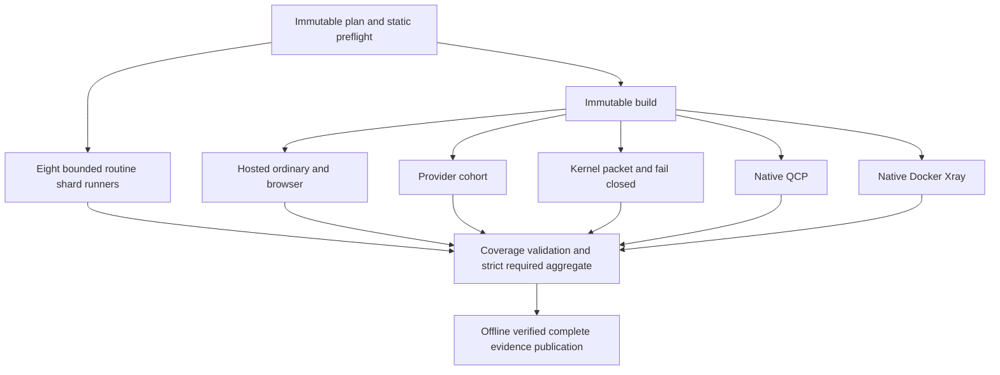

# CI V3: visible qualification and parallel execution

## Baseline and scope

The starting source is `ccb8de81be68585d95a327e6d1835ea7387de24a` (PR39). Actual-main run [39912198441](https://github.com/Coxf0rd/fwrouter/actions/runs/39912198441), attempt 1, completed all eight jobs successfully. Its downloaded main bundle passed the trusted-source offline verifier, including main smoke and safe recovery. The owner confirmed completion of the separate production rollout before implementation began. This CI change performs no deployment and does not qualify private deployment-wrapper bytes.

The baseline manifest registers 184 files: 110 L1, 34 L2, 34 L3, five L4 and one L7. There are 183 safe L1–L4 files. Ten L5 anchors retain their primary levels and must not be rerun merely to create a regression job. File profiles are 169 routine, seven qualified-child-process, six hosted-isolated-compose (including L7), and two kernel-packet. These are file counts, not individual cases.

The actual baseline routine report has 2,163 passing status entries. Hosted ordinary/provider/packet receipts add 27/12/4 cases; QCP and Docker-Xray add 43/1. Thus the baseline has 2,250 distinct reported IDs, **not a uniformly granular count of individual test methods**: stdlib suites previously used file-level status markers, and Node file wrappers coexist with TAP cases. Comparisons must retain this distinction when V3 exposes finer inventories. Never infer executed counts from manifest rows or green jobs.

## Trust and ownership

The existing gate manifest remains the source of test selection, primary levels, domains, dependency closure, L5 anchors and execution profiles. Deterministic partitions assign execution ownership; they do not reclassify levels or weaken baseline policy. The existing hosted/native strict validator remains authoritative after verified shard reports are reconstructed into its canonical routine-report contract.

Every selected suite must have exactly one executor. Producer evidence is untrusted until source, manifest, immutable plan, run and attempt identities, expected partition, file inventory and actual node results have been checked. Missing, duplicate, wrong-partition, uncollected, skipped, failed, stale-attempt or incomplete evidence cannot establish eligibility. Regression coverage validates evidence; it does not execute anchors twice.

The stable required check remains `Affected L0-L5 with hosted profiles`. Final evidence build, offline replay and publication stay within that job. Publication failure fails the required result. PR evidence cannot replace actual-main qualification. Missing or expired main evidence remains NO DEPLOY under the public manual-deployment contract.

## Execution graph

The diagram groups real runner instances rather than implying a new ownership service. QCP and Xray use separate native matrix children; routine matrix concurrency is bounded. Static checks stay with the planner and coverage validation with the required aggregate to avoid two runner startups/artifact handoffs that add no test isolation. Evidence publication remains steps of the required job, so publication failure cannot leave an eligible green required check.

## Trigger policy

| Mode | Qualification |
| --- | --- |
| Feature push | Existing fast affected L0–L1; explicit deferrals; non-promotional |
| Ordinary PR | Affected L0–L5 plus selected hosted/native/packet profiles |
| Final PR | `ci:full-acceptance` selects all mandatory safe L0–L5 at exact PR HEAD |
| Actual main | Full mandatory safe L0–L5 and independent main smoke |
| Nightly/manual L6 | Separate exact-source full safe regression; unchanged in PR A |
| Release | Fresh exact-release L6 plus independent mandatory main CI; separately authorized extra gates |
| L7 | Explicit authorized disposable staging only; never inferred from hosted success |

## Artifact lifecycle

Preserve PR39: runner-local intermediate state; one-day sealed cross-job handoffs; three-day redacted failed diagnostics; seven-day complete final evidence. No writable PR token, privileged cleanup workflow, production credentials or persistent runner is introduced. More visible jobs may increase short-lived handoff count; the long-lived result remains one complete evidence bundle. A checksum inventory detects content changes but is not a GitHub-origin signature; consumers must independently verify workflow/run metadata.

## PR B design: full L6 (not implemented by PR A)

Implementation must wait for owner Squash and Merge of PR A and successful actual-main verification. Keep the existing nightly/manual workflow operational until then. No PR B is opened in this step.

The full plan must select every safe registered file and exclude L7. Reuse the qualified partition/node-accounting contract from PR A with an explicit L6 mode. Proposed graph: full immutable plan → static/build and independent routine domain shards → independent hosted repeat 1 and repeat 2, QCP, Docker-Xray and packet/runtime-scale profiles → strict L6 aggregate → complete regression evidence. Runtime jobs wait only on their real build/profile prerequisites, not unrelated routine shards.

Both hosted repeats require distinct runtime ownership, projects/nonces, receipts and cleanup. Preserve `aggregate_hosted`'s `minimum_repeats=2`; a second copy of the same receipt is not an independent repeat. The exact full-plan node union, all required profiles, immutable source/runtime hashes, cleanup, baseline classification and regression anchors must pass before L6 eligibility. Final L6 evidence must preserve original validator inputs, not only a summary. Apply 1/3/7-day lifecycle through a separately reviewed change; the historical L6 workflow currently retains its existing 30-day output.

Measure collection/setup/startup, critical path, runner-minutes, transfer bytes, actual unique cases versus repeat executions and available resource receipts. Do not claim production Debian/systemd/reboot parity or L7 recovery from hosted L6. A pre-merge PR must never depend on a future main event.

## Measurement rules

Baseline run wall time is 458 seconds; sum of eight job durations is 26.0 runner-minutes (includes setup and transfer, excludes unmeasured queue/billing details). Routine and ordinary-hosted jobs took 370 and 371 seconds respectively; hosted already dominates the critical path. Routine sharding improves fault localization but cannot alone eliminate this hosted path. Native split trades duplicated provisioning for independent visibility and earlier failure diagnosis. Report measured trade-offs; no speedup percentage is accepted without comparable runs.

The latest historical L6 run inspected was [39755095242](https://github.com/Coxf0rd/fwrouter/actions/runs/39755095242) on `d313dcf`, with six hosted receipts and required repeat count two; it is historical evidence, not current-main L6 qualification.

Final implementation graph, partition distribution and exact-head measurements are recorded after qualification. Until then this document describes constraints and baseline evidence, not a completed CI V3 qualification.
