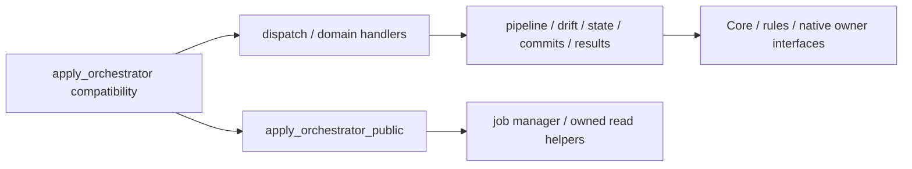

# `opt_fwrouter_api_fwrouter_api_services_apply_orchestrator_py.md`

## Purpose

Compatibility facade for apply orchestration; constants/jobs/results/state/drift/pipeline/commits/public helpers now live in focused `apply_orchestrator_*` modules.

## Notes

- Keep old import and monkeypatch paths stable.

## Stage 6.1 Package C — internal contracts

The public facade retains its existing explicit `__all__`, supported imports and
public operation identities. Public API, handlers, dispatch, pipeline and drift
modules now import their collaborators directly from canonical owners; none
imports or resolves the public facade. Default operations do not read alias
views or a shared dependency bag.

An explicit facade alias map preserves established attribute patch/restore
seams, including patch-before-first-dispatch. It forwards only to consumer-local
bindings that previously performed late facade lookups, not unrelated owner
modules. See [compatibility boundary](backend_fwrouter_api_services_module_attribute_aliases_py.md).
Eager compatibility wiring starts no worker, job, DB initialization or native
operation; fresh-process tests check both import orders, export identity and
first-dispatch patching. Import overhead is unmeasured.

Function bodies retain guard, transaction, native apply, Core/selection revision,
CAS, audit/settlement, error classification and last-good/recovery ordering. The
change removes dependency indirection; it does not create an apply owner, alter
Xray ownership, or authorize live operations. Ordinary direct-import snapshots
are not turned into new dynamic patch seams.
